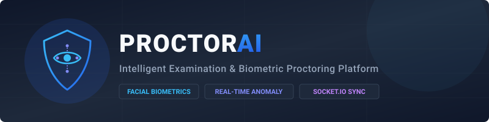
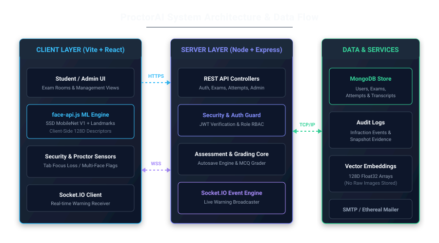

<div align="center">

  

  # ProctorAI: Intelligent Examination &amp; Biometric Proctoring Platform

  **An enterprise-grade, open-source online examination and automated proctoring platform featuring real-time facial recognition, anomaly detection, and academic integrity management.**

  <p align="center">
    <a href="LICENSE"></a>
    <a href="https://nodejs.org/"></a>
    <a href="https://react.dev/"></a>
    <a href="https://vitejs.dev/"></a>
    <a href="https://www.mongodb.com/"></a>
    <a href="https://socket.io/"></a>
  </p>

</div>

---

## Institutional Disclaimer

**Important Notice:** ProctorAI is an independent, open-source software project and is **not officially affiliated with, endorsed by, sponsored by, or operated by Mangalore Institute of Technology & Engineering (MITE)** or any collegiate institution. 

Any references to college names, branches, academic programs, or default email domains (such as `@mite.ac.in`) in code comments, test fixtures, or configuration defaults exist strictly as illustrative templates and historical sample data. Organizations and institutions deploying this platform must provide their own domain parameters, organizational identity, and environment configurations.

---

## Overview

ProctorAI addresses the operational and security challenges of remote academic assessments. By combining client-side deep neural networks for facial biometrics with an event-driven administrative monitoring engine, ProctorAI facilitates continuous identity verification, automated infraction tracking, and multi-tier assessment workflows without requiring intrusive native desktop installations.

---

## System Architecture

<div align="center">
  
</div>

The platform is structured into three decoupled layers:

1. **Client Tier (React 19 + Vite):** Hosts the candidate examination portal, the real-time proctor dashboard, and executes client-side face recognition through `@vladmandic/face-api` using WebGL / WASM acceleration.
2. **Server Tier (Node.js + Express + Socket.IO):** Coordinates candidate sessions, processes REST API requests, verifies JSON Web Tokens, manages autosave states, and broadcasts live disciplinary alerts via WebSockets.
3. **Data Tier (MongoDB):** Stores normalized records for user profiles, assessment questions, student submissions, audit logs, and 128-dimensional biometric mathematical descriptors.

---

## Key Capabilities

### Biometric Identity Verification
* **Pre-Exam Enrollment:** Candidates map their facial geometry through a web camera before taking assigned tests.
* **Client-Side Neural Inference:** Employs SSD MobileNet V1 and a 68-point facial landmark detector to generate 128-dimensional floating-point embeddings entirely within the client browser.
* **Continuous Face Matching:** Evaluates the live test-taker's Euclidean distance against the registered biometric baseline at regular intervals throughout the assessment.

### Automated Anomaly Detection
* **Absence Detection:** Identifies instances when the candidate steps away from the camera feed.
* **Multiple Face Detection:** Flags unauthorized individuals within the camera's visual field.
* **Gaze and Orientation Tracking:** Monitors when an examinee looks away from the monitor for extended durations.
* **Environment Lockdown:** Monitors window blur and browser visibility state to detect unauthorized tab switching.
* **Evidence Snapshot Logging:** Captures timestamped visual proof during verified infractions, cataloged directly into the audit registry.

### Assessment Management
* **Flexible Question Format:** Supports single-choice objective questions, multi-select items, and manual-graded subjective questions.
* **Automated Autosave Engine:** Regularly syncs candidate responses to the backend database to prevent data loss during network interruptions.
* **Instant Evaluation:** Automatically calculates scores and breakdowns for objective questions immediately upon submission.

### Administrative Command Center
* **Live Monitoring Hub:** Faculty and authorized proctors monitor active exam rooms and issue disciplinary messages in real time over WebSockets.
* **Cohort-Based Scheduling:** Configure tests restricted by degree stream, department branch, and graduation year.
* **Manual Grading Workflow:** Interface for instructors to review subjective answers, audit infraction snapshots, adjust scores, and publish transcripts.
* **Role-Based Access Control:** Distinct authorization boundaries separating Candidates, Proctors, and Administrators.

### Notification System
* **Two-Factor OTP Dispatch:** One-time verification codes for account onboarding and password recovery.
* **Automated Broadcasts:** Transactional emails informing students of newly published exam dates, score releases, and role modifications.
* **Virtual Test Mailer:** Automatically provisions an Ethereal SMTP test account when production SMTP credentials are not set.

---

## Security and Data Governance Policy

Data privacy and application security are primary architectural design principles in ProctorAI. The platform operates under the following policies:

### 1. Biometric Data Privacy
* **No Raw Image Retention for Biometrics:** Client devices extract facial landmark vectors locally. The backend only persists mathematical numerical arrays (128-dimensional Float32 vectors). Raw video feeds are never recorded or streamed continuously to storage.
* **Proctoring Snapshots:** Static webcam snapshots are captured solely upon a detected anomaly (e.g., absence or secondary face) to serve as verifiable audit proof for academic honor committees.
* **Access Boundary:** Violation images are accessible solely by authenticated proctors and institutional administrators through authenticated endpoints.

### 2. Secret and Environment Isolation
* **Zero Hardcoded Credentials:** Database connection strings, JWT signing keys, and mail transfer credentials must be configured via environment variables (`.env`).
* **Source Control Hygiene:** Environment files (`.env`, `.env.*`), build outputs, logs, and operating system metadata files (`.DS_Store`) are excluded from Git through multi-level `.gitignore` rules.

### 3. Authentication and Session Governance
* **Password Encryption:** All passwords undergo cryptographic salting and hashing using `bcryptjs` prior to storage.
* **Stateless Tokens:** API routes enforce JSON Web Token verification with strict expiration intervals.
* **Domain Whitelisting:** Deployers can enforce strict institutional domain validation (e.g., `@university.edu`) or enable open registration via `ALLOWED_EMAIL_DOMAIN=*`.

### 4. Vulnerability Reporting
For detailed instructions on submitting vulnerability disclosures, please review the [Security Policy](SECURITY.md).

---

## Repository Structure

```
College-Examproctor/
├── .github/
│   └── dependabot.yml       # Automated dependency monitoring configuration
├── assets/
│   ├── architecture-diagram.svg  # System architecture graphic
│   └── proctorai-banner.svg      # Platform banner graphic
├── backend/
│   ├── middleware/          # JWT verification and route protection
│   ├── models/              # Mongoose data schemas (User, Exam, Attempt, Log)
│   ├── routes/              # Express route controllers (Auth, Exam, Admin)
│   ├── utils/               # Transactional email and helper services
│   ├── .env.example         # Backend environment template
│   ├── package.json         # Backend dependencies and run scripts
│   └── server.js            # Server entry point and Socket.IO initialization
├── frontend/
│   ├── public/
│   │   └── models/          # Pre-trained face-api.js neural network weights
│   ├── src/
│   │   ├── context/         # AuthContext and ThemeContext state stores
│   │   ├── pages/           # Client views (Exam, Login, Dashboard, Admin)
│   │   ├── App.jsx          # Route configuration
│   │   ├── index.css        # Global styles and layout tokens
│   │   └── main.jsx         # Application entry point
│   ├── .env.example         # Frontend environment template
│   ├── package.json         # Frontend dependencies and scripts
│   └── vite.config.js       # Vite configuration with chunk allocation
├── .gitignore               # Root exclusion rules
├── LICENSE                  # MIT License terms
├── package.json             # Root runner scripts
├── README.md                # Technical platform documentation
└── SECURITY.md              # Vulnerability reporting and policy
```

---

## Getting Started

### Prerequisites

* **Node.js:** Version 18.0.0 or higher
* **npm:** Version 9.0.0 or higher
* **MongoDB:** Version 6.0 or higher (Local installation or MongoDB Atlas instance)

---

### Quickstart Setup

Clone the repository and install all workspace dependencies in a single step:

```bash
git clone https://github.com/anoopjogibettu/College-Examproctor.git
cd College-Examproctor
npm run install:all
```

#### Configure Environment Files

1. Create the backend configuration:
   ```bash
   cp backend/.env.example backend/.env
   ```

2. Create the frontend configuration:
   ```bash
   cp frontend/.env.example frontend/.env
   ```

#### Run the Services

Start the backend API and frontend dev server simultaneously in two terminal windows:

* **Terminal 1 (Backend Server):**
  ```bash
  npm run dev:backend
  ```

* **Terminal 2 (Frontend Client):**
  ```bash
  npm run dev:frontend
  ```

Access the client application at `http://localhost:5173`.

---

## Environment Configuration

### Backend (`backend/.env`)

| Parameter | Type | Default | Description |
|---|---|---|---|
| `PORT` | Number | `5000` | Port on which Express and Socket.IO listen |
| `NODE_ENV` | String | `development` | Runtime environment (`development` or `production`) |
| `MONGODB_URI` | String | `mongodb://127.0.0.1:27017/examproctor` | MongoDB connection URI |
| `JWT_SECRET` | String | *Required* | Cryptographic secret for signing session tokens |
| `FRONTEND_URL` | String | `http://localhost:5173` | Host URL of client application for email links |
| `ALLOWED_EMAIL_DOMAIN` | String | `*` | Institutional domain restriction (`*` to allow all) |
| `PORTAL_NAME` | String | `ProctorAI Examination Portal` | Name used in notification headers |
| `SMTP_HOST` | String | *Optional* | Mail host (Omit to use Ethereal virtual SMTP) |
| `SMTP_PORT` | Number | `587` | Port for outgoing mail transport |
| `SMTP_EMAIL` | String | *Optional* | Username for authenticated mail server |
| `SMTP_PASSWORD` | String | *Optional* | Password for authenticated mail server |
| `FROM_NAME` | String | `ProctorAI Exam Cell` | Sender display name |
| `FROM_EMAIL` | String | `noreply@proctorai.com` | Sender address |

### Frontend (`frontend/.env`)

| Parameter | Type | Default | Description |
|---|---|---|---|
| `VITE_API_URL` | String | `http://localhost:5000` | Target URL for REST endpoints and WebSockets |

---

## Biometric Machine Learning Models

Client-side biometric inference is powered by TensorFlow.js models loaded from `frontend/public/models/`:

* **SSD MobileNet V1:** High-accuracy convolutional face detector optimized for browser execution (`ssd_mobilenetv1_model`).
* **Face Landmark 68:** Identifies critical facial feature positions (jawline, eyebrows, eyes, nose, mouth) for pose estimation (`face_landmark_68_model`).
* **Face Recognition Model:** Computes a distinct 128-dimensional embedding from facial landmarks (`face_recognition_model`).

Vite serves these static files from `/models` so candidate browsers load neural weights directly without third-party network calls.

---

## API Specification

### Core Endpoints

| Method | Route | Description | Authorization |
|---|---|---|---|
| `POST` | `/api/auth/send-otp` | Generate and dispatch an email verification code | Public |
| `POST` | `/api/auth/register` | Register an account using a verified OTP code | Public |
| `POST` | `/api/auth/login` | Authenticate credentials and receive a JWT token | Public |
| `GET` | `/api/auth/profile` | Retrieve the authenticated user profile | Bearer Token |
| `POST` | `/api/auth/face-register` | Store the candidate's initial biometric vector | Candidate |
| `GET` | `/api/exams` | Retrieve scheduled exams matching candidate cohort | Candidate |
| `POST` | `/api/exams/create` | Schedule an examination session | Instructor / Admin |
| `POST` | `/api/attempts/start` | Initialize an exam attempt session | Candidate |
| `PATCH` | `/api/attempts/:id/autosave` | Periodically persist test response state | Candidate |
| `POST` | `/api/attempts/:id/violation` | Log an anomaly event with snapshot proof | Candidate |
| `POST` | `/api/attempts/:id/submit` | Finalize attempt and execute scoring | Candidate |
| `GET` | `/api/admin/logs` | Query candidate infraction audit history | Proctor / Admin |
| `GET` | `/api/admin/attempts` | Inspect attempt records and subjective responses | Proctor / Admin |
| `PUT` | `/api/admin/attempts/:id/grade` | Submit manual subjective grades | Proctor / Admin |

### WebSocket Events (Socket.IO)

| Event Name | Direction | Payload | Description |
|---|---|---|---|
| `join_room` | Client to Server | `roomId` (String) | Enters a private monitoring room for an exam session |
| `proctor_message` | Client to Server | `{ roomId, message }` | Dispatches a direct warning to a student |
| `alert_message` | Server to Client | `{ message, timestamp }` | Displays a live alert overlay in the exam session |

---

## License

This software is licensed under the [MIT License](LICENSE).
