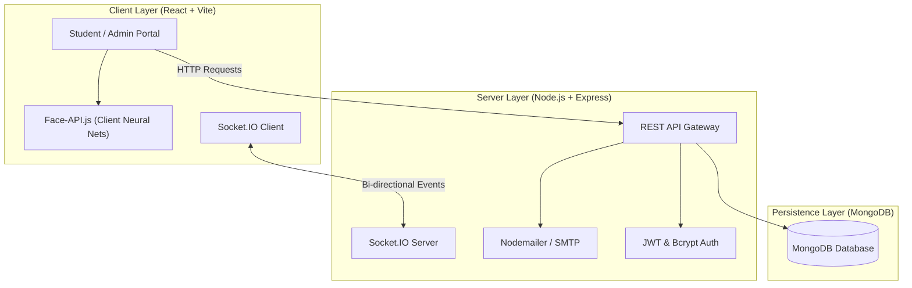

<div align="center">

  

  # ProctorAI: Intelligent Examination & Biometric Proctoring Platform

  **An enterprise-grade, AI-powered online examination and automated proctoring platform featuring real-time facial recognition, anomaly detection, and academic integrity management.**

  [](LICENSE)
  [](https://nodejs.org/)
  [](https://react.dev/)
  [](https://vitejs.dev/)
  [](https://www.mongodb.com/)
  [](https://socket.io/)

</div>

---

## 📌 Overview

**ProctorAI** solves the scalability and security challenges of remote academic assessments. By integrating client-side deep neural networks for facial biometrics and an event-driven real-time proctoring engine, ProctorAI ensures continuous identity verification, automated infraction logging, and seamless assessment management.

---

## 🚀 Key Features

### 👤 Biometric Identity Registration
- **Pre-Exam Facial Mapping:** Students register their facial geometry using their webcam prior to taking assessments.
- **Deep Learning Embeddings:** Employs `@vladmandic/face-api` (SSD MobileNet V1 & 68-point landmark detector) to compute 128-dimensional biometric descriptors stored securely in MongoDB.

### 🛡️ Automated AI Proctoring
- **Continuous Identity Verification:** Compares the live examinee's facial descriptors against their registered biometric baseline throughout the exam.
- **Multi-Anomaly Detection:** Flags infractions in real time:
  - ❌ *No Face Detected* (student stepped away)
  - 👥 *Multiple Faces Detected* (unauthorized assistance)
  - 👀 *Looking Away / Gaze Deviation*
  - 📑 *Tab Switching / Focus Loss* (browser-level lock enforcement)
- **Snapshot Evidence Logging:** Automatically captures webcam snapshots and violation timestamps during infractions, storing audit logs for administrative review.

### 📝 Assessment Engine & Lifecycle
- **Dynamic Question Types:** Supports single-choice, multiple-choice, and manual-graded subjective questions.
- **Resilient Exam Sessions:** Client-side autosave preserves responses against unexpected network interruptions.
- **Automated Grading:** Instant objective evaluation and detailed score breakdown upon test submission.

### 📊 Administrative Command Center
- **Live Proctoring Feed:** Proctors and faculty can observe real-time exam rooms and send instant alerts to students via WebSockets (Socket.IO).
- **Exam Scheduling & Target Cohorts:** Configure tests filtered by academic stream, branch, and semester year.
- **Subjective Evaluation Workflow:** Review student submissions, examine infraction logs with photo evidence, and publish final transcripts.
- **Role-Based Access Control (RBAC):** Granular permissions for Students, Proctors/Moderators, and Administrators.

### 📧 Transactional Notifications
- **Email Verification & OTP:** One-Time Password verification for student registration and password resets.
- **Automated Alerts:** Broadcasts exam schedules, result publishing notices, and administrative role updates.
- **Zero-Config Fallback:** Automatically spins up an Ethereal virtual mailer if production SMTP credentials are not configured.

---

## 🏗️ System Architecture



---

## 📁 Repository Structure

```
College-Examproctor/
├── assets/                  # Brand assets and visual media for documentation
│   ├── logo.svg
│   └── logo_name.png
├── backend/                 # Express.js REST API & Socket.IO server
│   ├── middleware/          # JWT authentication and role protection
│   ├── models/              # Mongoose schemas (User, Exam, Attempt, Log, etc.)
│   ├── routes/              # API route controllers (Auth, Exam, Admin, Attempt)
│   ├── utils/               # Email and utility helper modules
│   ├── .env.example         # Backend environment variables template
│   ├── package.json
│   └── server.js            # Main backend entry point
├── frontend/                # React 19 single-page application (Vite)
│   ├── public/              # Static assets, icons, and pre-trained face-api models
│   │   └── models/          # Neural network weights for face detection
│   ├── src/
│   │   ├── context/         # AuthContext and ThemeContext state management
│   │   ├── pages/           # Application views (Login, ExamSession, AdminDashboard, etc.)
│   │   ├── App.jsx          # Route declarations and layout wrappers
│   │   ├── index.css        # Responsive styling and CSS design system
│   │   └── main.jsx         # React application entry point
│   ├── .env.example         # Frontend environment variables template
│   ├── package.json
│   └── vite.config.js       # Vite configuration with chunk splitting
├── .gitignore               # Root gitignore excluding secrets and build outputs
├── package.json             # Root monorepo script runner
└── README.md                # Project documentation
```

---

## ⚙️ Getting Started

### Prerequisites

Ensure the following tools are installed on your machine:
- [Node.js](https://nodejs.org/) (v18.0.0 or higher recommended)
- [npm](https://www.npmjs.com/) (v9.0.0 or higher)
- [MongoDB](https://www.mongodb.com/) (Local Community Server or a free [MongoDB Atlas](https://www.mongodb.com/atlas) cluster)

---

### Quickstart (Single-Command Setup)

From the project root:

1. **Install dependencies for both frontend and backend:**
   ```bash
   npm run install:all
   ```

2. **Configure environment variables:**
   - Copy `backend/.env.example` to `backend/.env`
   - Copy `frontend/.env.example` to `frontend/.env`

3. **Start services:**
   - In Terminal 1 (Backend):
     ```bash
     npm run dev:backend
     ```
   - In Terminal 2 (Frontend):
     ```bash
     npm run dev:frontend
     ```

Open your browser at **`http://localhost:5173`**.

---

### Manual Setup

#### 1. Backend Configuration

```bash
cd backend
npm install
cp .env.example .env
```

Configure `backend/.env`:

| Variable | Description | Default / Example |
|---|---|---|
| `PORT` | HTTP & WebSocket server port | `5000` |
| `NODE_ENV` | Application environment mode | `development` |
| `MONGODB_URI` | MongoDB connection string | `mongodb://127.0.0.1:27017/examproctor` |
| `JWT_SECRET` | Secret key used to sign session tokens | `your_secure_jwt_secret` |
| `FRONTEND_URL` | Base URL of the client app (for email links) | `http://localhost:5173` |
| `ALLOWED_EMAIL_DOMAIN` | Restrict registration domain (`*` to allow all) | `@mite.ac.in` |
| `PORTAL_NAME` | Display name of the institutional portal | `MITE Exam Portal` |
| `SMTP_HOST` | *(Optional)* SMTP mail server host | *Empty (uses Ethereal)* |
| `SMTP_PORT` | *(Optional)* SMTP mail port | `587` |
| `SMTP_EMAIL` | *(Optional)* Mail user account | *Empty* |
| `SMTP_PASSWORD` | *(Optional)* Mail user password / App Password | *Empty* |

Start the backend:
```bash
npm start
```

#### 2. Frontend Configuration

```bash
cd ../frontend
npm install
cp .env.example .env
```

Configure `frontend/.env`:

| Variable | Description | Default |
|---|---|---|
| `VITE_API_URL` | Target backend REST and WebSocket URL | `http://localhost:5000` |

Start the Vite development server:
```bash
npm run dev
```

---

## 🤖 Face Recognition Models

The biometric verification engine requires pre-trained TensorFlow.js model weights. These weights are bundled directly in:

```
frontend/public/models/
├── ssd_mobilenetv1_model-weights_manifest.json
├── ssd_mobilenetv1_model-shard1 & shard2
├── face_landmark_68_model-weights_manifest.json
├── face_landmark_68_model-shard1
├── face_recognition_model-weights_manifest.json
└── face_recognition_model-shard1 & shard2
```

Vite serves these static assets automatically from `/models` so the client-side model loader initializes without external network dependencies.

---

## 📡 API & WebSocket Reference

### Core REST Endpoints

| Method | Endpoint | Description | Access |
|---|---|---|---|
| `POST` | `/api/auth/send-otp` | Generate and dispatch registration OTP | Public |
| `POST` | `/api/auth/register` | Register new user with verified OTP | Public |
| `POST` | `/api/auth/login` | Authenticate and obtain JWT token | Public |
| `GET` | `/api/auth/profile` | Retrieve profile of authenticated user | Private |
| `POST` | `/api/auth/face-register` | Save biometric face descriptor baseline | Private (Student) |
| `GET` | `/api/exams` | List available exams for cohort | Private (Student) |
| `POST` | `/api/exams/create` | Schedule a new examination | Admin / Faculty |
| `POST` | `/api/attempts/start` | Initialize test attempt session | Private (Student) |
| `PATCH` | `/api/attempts/:id/autosave` | Persist live answers during exam | Private (Student) |
| `POST` | `/api/attempts/:id/violation` | Log infraction with webcam snapshot | Private (Student) |
| `POST` | `/api/attempts/:id/submit` | Finalize exam and trigger evaluation | Private (Student) |
| `GET` | `/api/admin/logs` | Fetch real-time proctoring audit logs | Admin |
| `GET` | `/api/admin/attempts` | Audit student attempts and manual grade | Admin |

### Real-Time WebSocket Events (Socket.IO)

- `join_room`: Joins an active proctoring room identified by examination or attempt ID.
- `proctor_message`: Proctors dispatch warnings directly to an active examinee's screen.
- `alert_message`: Receives real-time disciplinary notifications inside the exam room.

---

## 🔒 Security & Privacy Notice

- **No Secrets in Source:** All sensitive credentials (database strings, JWT secrets, SMTP credentials) must be supplied via `.env` files. Never commit `.env` to source control.
- **Biometric Security:** Biometric face descriptors are stored as mathematical vector embeddings rather than raw webcam photos, preserving student privacy.
- **Production Deployment:** In production environments, always set strict CORS origins, enforce HTTPS for webcam media access (`getUserMedia`), and configure a secure MongoDB cluster.

---

## 📄 License

This project is licensed under the [MIT License](LICENSE).
